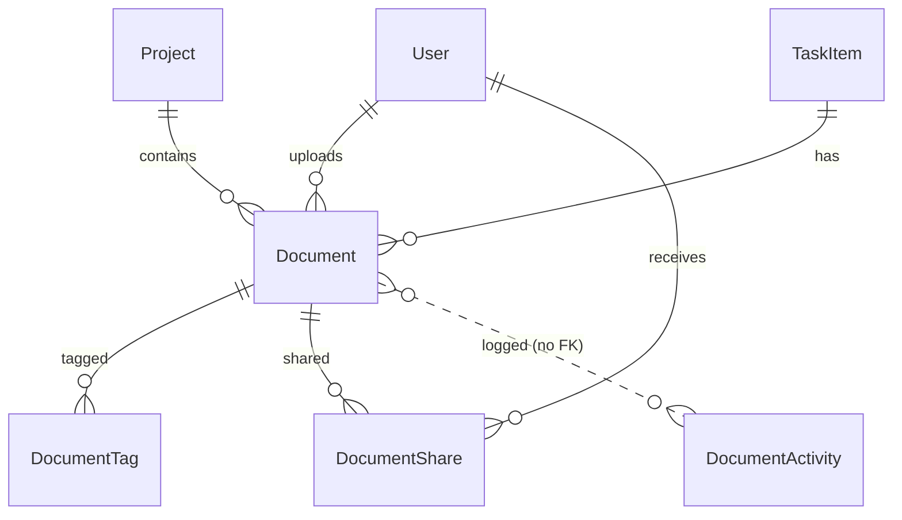

# Data Model: Document Upload and Management

All entities are added to `ApplicationDbContext` (SQLite via EF Core). Keys are integers, consistent with `User` and `Project`.

## Document

| Field | Type | Rules |
|-------|------|-------|
| `DocumentId` | int, PK | Generated |
| `Title` | string(255) | Required |
| `Description` | string(2000)? | Optional |
| `Category` | string(50) | Required; one of `Project Documents`, `Team Resources`, `Personal Files`, `Reports`, `Presentations`, `Other` (text, not enum) |
| `OriginalFileName` | string(255) | Required; metadata only, never used in a storage path |
| `FileType` | string(255) | Required; server-derived MIME type |
| `FileSize` | long | Required; 1 to 26,214,400 bytes |
| `FilePath` | string(500) | Required; relative `{userId}/{projectId or "personal"}/{guid}.{ext}`; **unique index** |
| `UploadedByUserId` | int, FK to `User` | Required; restrict delete |
| `UploadDate` | DateTime (UTC) | Set on create |
| `UpdatedDate` | DateTime (UTC) | Set on edit or replace |
| `ProjectId` | int?, FK to `Project` | Optional; restrict delete |
| `TaskId` | int?, FK to `TaskItem` | Optional; at most one task; when set, `ProjectId` equals the task's project |

Indexes: `UploadedByUserId`, `ProjectId`, `TaskId`, `Category`, `UploadDate`, unique `FilePath`.

State: created on successful upload; edited (metadata, file replaced, attached to task); deleted (row and file removed permanently, activity retained).

## DocumentTag

| Field | Type | Rules |
|-------|------|-------|
| `DocumentTagId` | int, PK | |
| `DocumentId` | int, FK to `Document` | Cascade delete |
| `Tag` | string(50) | Required; trimmed, lowercase; unique per document |

Index: `Tag`; unique (`DocumentId`, `Tag`).

## DocumentShare

| Field | Type | Rules |
|-------|------|-------|
| `DocumentShareId` | int, PK | |
| `DocumentId` | int, FK to `Document` | Cascade delete |
| `SharedWithUserId` | int?, FK to `User` | Set for a user share |
| `SharedWithDepartment` | string(100)? | Set for a team (department) share |
| `SharedByUserId` | int, FK to `User` | Must equal the document owner |
| `SharedDate` | DateTime (UTC) | |

Rule: exactly one of `SharedWithUserId` or `SharedWithDepartment` is set. Unique (`DocumentId`, `SharedWithUserId`) and (`DocumentId`, `SharedWithDepartment`). Read-only access only (no permission field).

## DocumentActivity

| Field | Type | Rules |
|-------|------|-------|
| `DocumentActivityId` | int, PK | |
| `DocumentId` | int | **No foreign key**, so history survives deletion |
| `DocumentTitle` | string(255) | Snapshot at action time |
| `DocumentFileType` | string(255) | Snapshot at action time |
| `UserId` | int | Acting user |
| `Action` | string(20) | `Upload`, `Download`, `Preview`, `Delete`, `Share` (text) |
| `ActivityDate` | DateTime (UTC) | |

Indexes: `DocumentId`, `UserId`, (`Action`, `ActivityDate`). Never updated or deleted by the application.

## Changes to existing entities

- `NotificationType`: append `DocumentShared`, `DocumentAdded` (keeps existing integer values).
- `DashboardSummary`: add `TotalDocuments`.
- `User`, `Project`, `TaskItem`: add navigation collections for documents (no schema change beyond FKs on `Document`).

## Relationships

## Validation rules (service level)

- Title required, 1 to 255 chars; description at most 2000; at most 10 tags of 1 to 50 chars each.
- Category must be in the fixed list.
- Extension in allow-list, content signature matches, size within limit, non-empty, scan passes.
- Project association requires membership, management, or Administrator role.
- Share target must exist; cannot share with self; recipient set is a user or a department.
